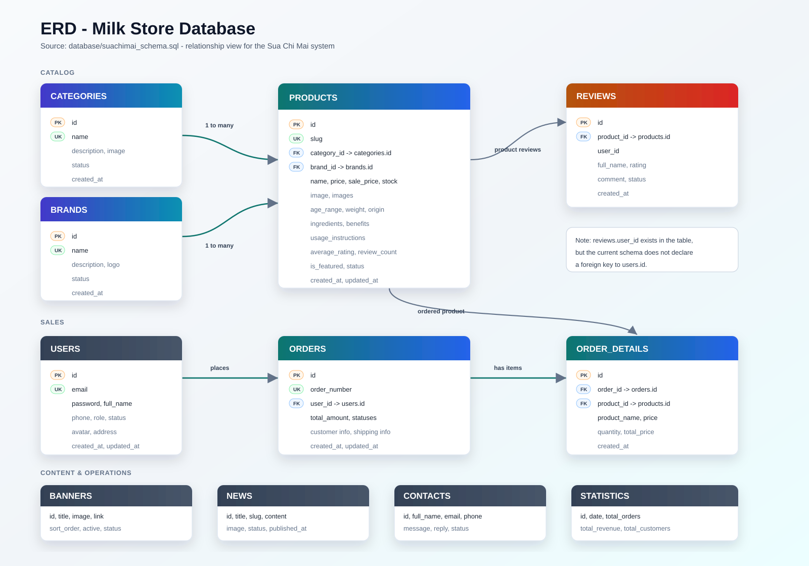
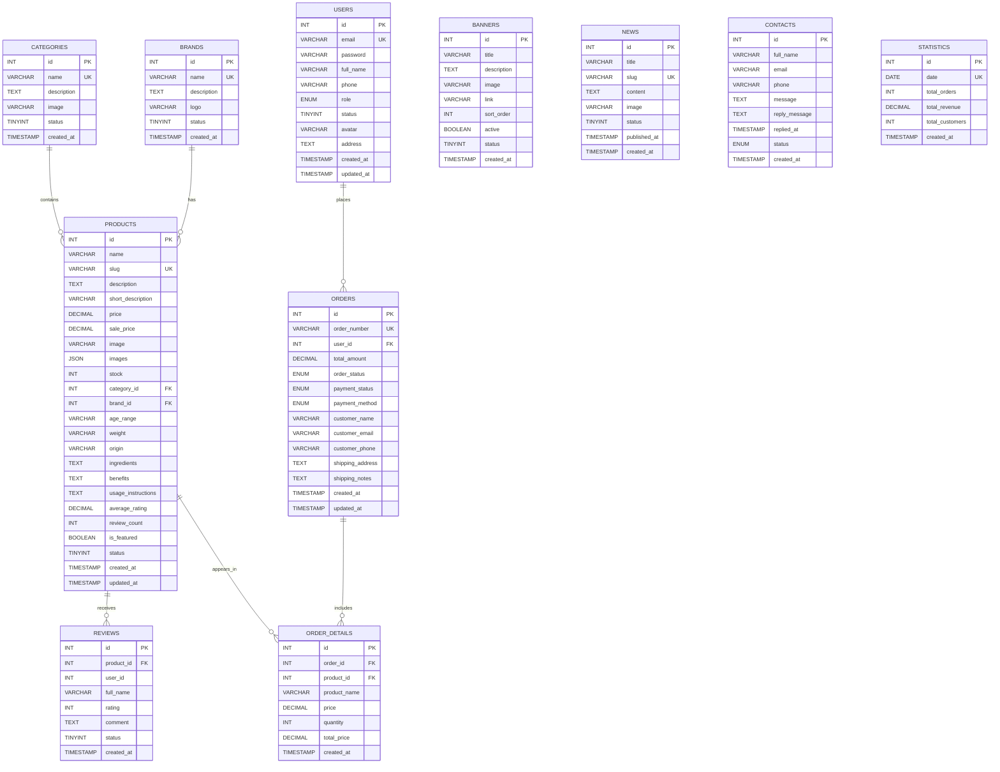

# ERD - Milk Store Database

Source: `database/milk_store.sql` (runtime schema).

## Relationship Notes

- `categories.id` -> `products.category_id`: one category has many products.
- `brands.id` -> `products.brand_id`: one brand has many products.
- `products.id` -> `reviews.product_id`: one product has many reviews.
- `users.id` -> `orders.user_id`: one user has many orders.
- `orders.id` -> `order_details.order_id`: one order has many order detail rows.
- `products.id` -> `order_details.product_id`: one product can appear in many order detail rows.
- `reviews.user_id` references `users.id` (ON DELETE CASCADE) in `milk_store.sql`.
- `contacts` is a standalone table for customer messages.
